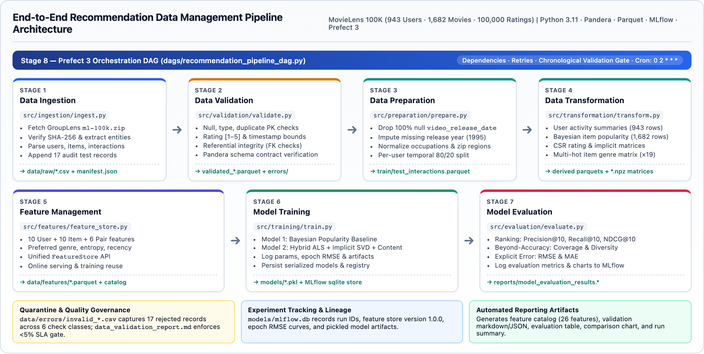
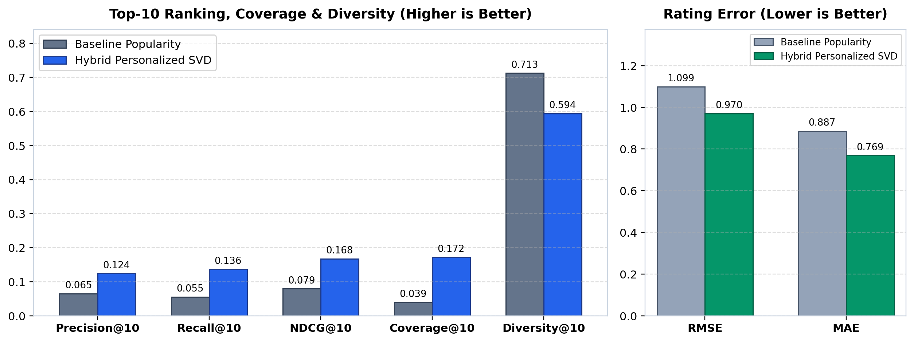

# End-to-End Recommendation System Data Management Pipeline

**Author:** Chandan M K (`2025ag05158@wilp.bits-pilani.ac.in` · ID: `2025ag05158`)  
**Course:** Data Management for Machine Learning (`AIMLZG529`) — Assignment 2  
**Repository:** [https://github.com/chandan2738/movielens-recsys-data-pipeline](https://github.com/chandan2738/movielens-recsys-data-pipeline)

An end-to-end, modular, reproducible data management and ML pipeline built on the **MovieLens 100K** dataset (`943` users, `1,682` movies, `100,000` ratings). It automates **Data Ingestion**, **Pandera Data Validation & Quarantine**, **Preparation & Per-User Temporal Splitting**, **Sparse Matrix Transformation**, **Reusable Feature Management**, **Baseline vs. Hybrid Model Training with MLflow Tracking**, **Top-K & Error Evaluation**, and **Prefect 3 DAG Orchestration**.

---

## Architecture



| Stage | Module | Responsibilities | Key Outputs |
|---|---|---|---|
| **1. Data Ingestion** | `src/ingestion/ingest.py` | Downloads/verifies `ml-100k.zip` (SHA-256), parses entities & interactions, injects 17 documented audit test records | `data/raw/*.csv`, `ingestion_manifest.json` |
| **2. Data Validation** | `src/validation/validate.py` | Checks nulls, dtypes, duplicates, rating `[1, 5]`, timestamps, FK referential integrity, Pandera schemas; enforces `<5%` error gate | `data/errors/invalid_*.csv`, `data_validation_report.md` |
| **3. Data Preparation** | `src/preparation/prepare.py` | Drops 100%-null `video_release_date`, imputes release year, normalizes text/zip regions, runs per-user temporal 80/20 split | `train_interactions.parquet`, `test_interactions.parquet` |
| **4. Data Transformation** | `src/transformation/transform.py` | Builds leakage-free derived user/item summaries and sparse CSR matrices (`943 × 1682` rating/implicit, `1682 × 19` genre) | `user_activity_summary.parquet`, `item_popularity.parquet`, `*.npz` |
| **5. Feature Management** | `src/features/feature_store.py` | Materializes 26 User, Item, and Interaction features (`FeatureStore`) reusable for both batch training and online inference | `data/features/*.parquet`, `reports/feature_catalog.md` |
| **6. Model Training** | `src/training/train.py` | Trains Baseline `PopularityRecommender` & Personalized `HybridSVDRecommender` (ALS + Implicit SVD + Content), tracks in MLflow | `models/*.pkl`, `models/model_registry.json`, MLflow DB |
| **7. Model Evaluation** | `src/evaluation/evaluate.py` | Evaluates `Precision@10`, `Recall@10`, `NDCG@10`, `Coverage@10`, `Diversity@10`, `RMSE`, `MAE`; logs metrics & plots to MLflow | `reports/model_evaluation_results.*`, `model_comparison.png` |
| **8. Orchestration** | `dags/recommendation_pipeline_dag.py` | Prefect 3 DAG (`@flow` + 7 `@task`s) with upstream dependencies, retries, timing telemetry, and cron schedule (`0 2 * * *`) | `reports/orchestration_run_summary.json` |

---

## Project Structure

```text
├── configs/
│   └── pipeline_config.yaml         # Centralized pipeline hyperparameters, thresholds & paths
├── dags/
│   └── recommendation_pipeline_dag.py  # Prefect 3 end-to-end orchestration flow & cron runner
├── data/
│   ├── raw/                         # Staged CSV files & ingestion manifest
│   ├── processed/                   # Validated Parquets, train/test splits, derived summaries & CSR matrices
│   ├── features/                    # Materialized Feature Store tables & metadata
│   └── errors/                      # Quarantined invalid records with error_code & error_reason
├── models/                          # Trained model artifacts (.pkl) & model_registry.json
├── reports/                         # Architecture diagram, validation/evaluation/feature reports & screenshots
├── src/
│   ├── utils/config.py              # Config loader, path resolution & Rich console logging
│   ├── ingestion/ingest.py          # Stage 1: MovieLens 100K ingestion
│   ├── validation/validate.py       # Stage 2: Pandera & integrity validation + quarantine
│   ├── preparation/prepare.py       # Stage 3: Cleaning & chronological per-user 80/20 split
│   ├── transformation/transform.py  # Stage 4: User/item summaries & sparse matrices
│   ├── features/feature_store.py    # Stage 5: FeatureStore (training + inference) & catalog
│   ├── training/models.py           # PopularityRecommender & HybridSVDRecommender classes
│   ├── training/train.py            # Stage 6: Model training & MLflow run logging
│   └── evaluation/evaluate.py       # Stage 7: Evaluation metrics, charts & MLflow logging
├── requirements.txt
└── README.md
```

---

## Setup & Execution

### 1. Install Dependencies
```bash
python3 -m venv .venv
source .venv/bin/activate
pip install -r requirements.txt
```

### 2. Run Complete Orchestrated Pipeline (Recommended)
Executes all 7 downstream stages via **Prefect 3** with dependency enforcement and retries:
```bash
python3 -m dags.recommendation_pipeline_dag
```
To register and serve on the configured cron schedule (`0 2 * * *`):
```bash
python3 -m dags.recommendation_pipeline_dag --serve
```

### 3. Run Individual Stages Manually
```bash
python3 -m src.ingestion.ingest
python3 -m src.validation.validate
python3 -m src.preparation.prepare
python3 -m src.transformation.transform
python3 -m src.features.feature_store
python3 -m src.training.train
python3 -m src.evaluation.evaluate
```

### 4. Inspect MLflow Experiment Tracking UI
```bash
mlflow ui --backend-store-uri sqlite:///models/mlflow.db --port 5000
```

---

## Key Results

### Data Quality & Quarantine (Stage 2)
All `17` injected malformed records (`4` users, `3` items, `10` interactions covering missing fields, invalid types, out-of-range ages/ratings/timestamps, duplicate PKs, and foreign-key violations) were isolated to `data/errors/invalid_*.csv`, leaving exact clean `943` users, `1,682` items, and `100,000` interactions verified by Pandera contracts (`reports/data_validation_report.md`).

### Model Evaluation Comparison (`K = 10`, Relevant Rating `>= 4.0`)

| Metric | Baseline Popularity | Hybrid Personalized SVD | Relative Improvement |
|---|---:|---:|---:|
| **Precision@10** | 0.0650 | **0.1239** | +90.6% |
| **Recall@10** | 0.0554 | **0.1360** | +145.5% |
| **NDCG@10** | 0.0792 | **0.1675** | +111.5% |
| **Catalog Coverage@10** | 0.0392 | **0.1718** | +338.3% |
| **Intra-List Diversity@10** | 0.7127 | **0.5940** | -16.7% |
| **RMSE** (lower is better) | 1.0991 | **0.9703** | +11.7% |
| **MAE** (lower is better) | 0.8870 | **0.7690** | +13.3% |



See [`reports/feature_catalog.md`](reports/feature_catalog.md), [`reports/data_validation_report.md`](reports/data_validation_report.md), and [`reports/model_evaluation_results.md`](reports/model_evaluation_results.md) for full generated reports.
